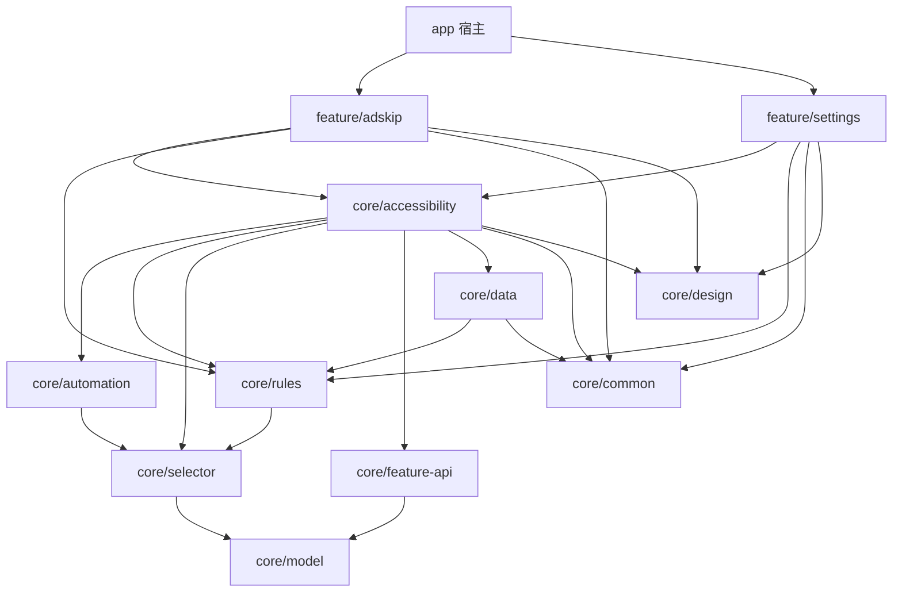

# wave工具箱 · 架构说明

> 面向贡献者与二次开发的工程结构说明。产品定位见 [README](README.md)。

## 设计原则

1. **单向依赖**：`app → feature → core`，无反向依赖、无环。
2. **特性零耦合**：`feature/*` 之间互不依赖，新增/移除特性不动其他特性。
3. **引擎无 UI**：`core` 全层不含 Compose 页面；UI 只存在于 `app` 与 `feature`。
4. **SPI 注册**：特性实现 `core:feature-api` 的 `ToolFeature` 接口，由 `FeatureRegistry` 在运行时按开关分发无障碍事件。
5. **纯本地**：无网络权限；规则、统计、日志全部落本地（Room / DataStore）。

## 模块总览（12 模块）

```
wave-toolbox
├── app                        宿主：入口 / 导航 / 首页（MainActivity · AppNavHost · ui/home）
│
├── core
│   ├── feature-api            特性 SPI：ToolFeature · FeatureEvent · FeaturesModule（Hilt 注册）
│   ├── accessibility          无障碍引擎：服务入口 / 事件管线 / 动作执行 / 保活
│   │   ├── AccessibilityServiceBootstrap.kt      服务入口与绑定
│   │   ├── pipeline/                             事件管线（过滤 · 队列 · 去抖 · ANR 防护 · 活动窗口跟踪）
│   │   ├── action/                               动作执行（RuleEngine · ClickResolver · ClickVerifier · ActionLedger）
│   │   ├── keepalive/                            保活（前台通知 · 开机自启 · 引擎开关广播）
│   │   └── feature/FeatureRegistry.kt            特性注册与事件分发
│   ├── automation             任务编排抽象：Step · TaskEnvironment · TaskExecutor
│   ├── selector               选择器引擎：Selector DSL · 解析 · 匹配 · 快照树（SnapshotTree）
│   ├── rules                  规则层：RawRule · RuleParser · RuleIndex · 包名/版本匹配 · 内置规则装载
│   ├── data                   持久化：Room（规则 · 统计）· DataStore（设置）
│   ├── design                 设计系统：Wave 主题令牌 · 通用组件
│   ├── common                 公共设施：协程调度器 · 类名工具
│   └── model                  基础模型（预留最小模块）
│
└── feature
    ├── adskip                 开屏广告自动跳过：识别管线 · 策略 · 按应用三态 · 内置规则包（24 条）
    └── settings               设置 / 引导 / 诊断 / 事件日志 / 品牌组件
```

## 依赖方向



（`feature/adskip` 与 `feature/settings` 之间无直接依赖：共享能力全部下沉到 `core`。）

## 运行时链路

**事件主链（无障碍为止）**

```
AccessibilityEvent
  └─ pipeline/EventPipeline        过滤无关包 · 队列合并 · 内容去抖 · ANR 防护
      └─ FeatureRegistry           仅分发给「已启用」特性
          └─ ToolFeature.onEvent   （feature/adskip 在此决策）
              └─ SelectorEngine    对 WindowSnapshot 执行选择器匹配
                  └─ ActionExecutor / ClickResolver   执行点击
                      └─ ClickVerifier + ActionLedger 点击复核 · 去重 · 统计
```

**规则链**

`assets/rules/<feature>/*.json5` → `BuiltinRuleLoader` → `RuleRepository`（Room 落库，支持覆盖）→ `RuleIndex` + `ActivityMatcher/VersionMatcher`（按包名 / Activity / 版本命中）。

**保活链**

`KeepAliveService`（前台通知）· `BootReceiver`（开机自启）· `AccessibilitySelfHeal`（断连自愈）· `AccessibilityStateMonitor`（状态看板）。

## 新增一个特性

1. `settings.gradle.kts` 注册 `:feature:<name>`；
2. 依赖 `core:feature-api`（按需 `core:selector` / `core:rules` / `core:design` 等），**不要**依赖其他 `feature`；
3. 实现 `ToolFeature`（事件入口 + 设置面板 Composable），Hilt 绑定至 `FeaturesModule`；
4. 规则放入 `assets/rules/<name>/`（JSON5，逐包一条）；
5. `app` 添加模块依赖，其余零改动：开关、事件分发、日志、统计均由引擎层统一提供。

## 阅读导引

1. `core/feature-api/ToolFeature.kt` —— 先看特性契约（一个特性长什么样）；
2. `core/accessibility/AccessibilityServiceBootstrap.kt` + `pipeline/EventPipeline.kt` —— 引擎如何收事件、发事件；
3. `feature/adskip/AdSkipFeature.kt` + `strategy/Providers.kt` —— 一个真实特性的完整决策链；
4. `core/selector/SelectorEngine.kt` + `core/rules/` —— 选择器与规则命中机制；
5. `app/MainActivity.kt` + `ui/nav/AppNavHost.kt` —— 宿主与 UI 组织方式。

## 质量门禁

```bash
./gradlew test lint :app:assembleDebug   # 全绿方可提交（等价脚本 scripts/ci.sh）
```

CI（GitHub Actions）在 push / PR 上执行同一脚本；提交前另有代码图影响面审计（GitNexus）与真机走查。
