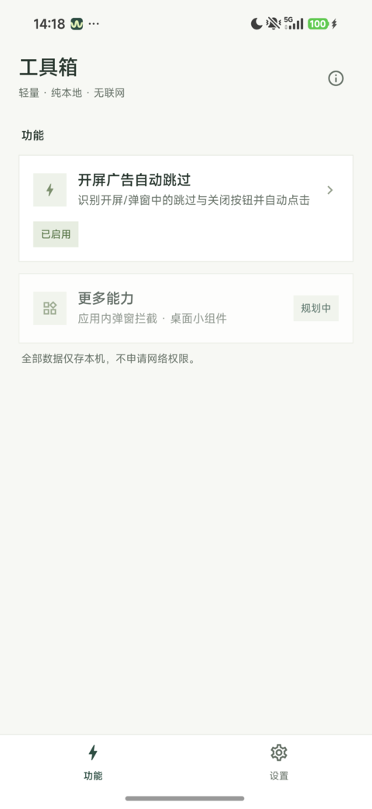
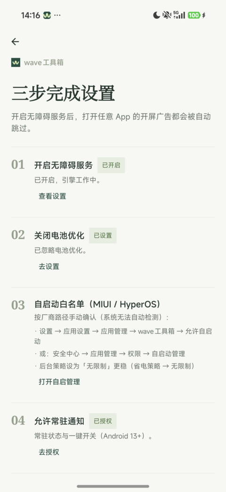

<p align="center">
  
</p>

<h1 align="center">wave工具箱</h1>

<p align="center">
  免 root 的安卓无障碍工具箱 —— 把手机上各种零散重复操作交给一个 App 自动完成。
  <br>
  <sub>Android 无障碍服务驱动 · 纯本地运行 · 仅检查更新时联网</sub>
</p>

<p align="center">
  <a href="https://github.com/wavexzore/wave-toolbox/actions/workflows/ci.yml"></a>
  <a href="LICENSE"></a>
  
  
</p>

---

## 功能

### 开屏广告自动跳过（v1.0.0 首个正式功能）

任意 App 冷启动时自动点击「跳过 / 关闭」，覆盖未适配应用，误点最少：

| 能力 | 说明 |
|---|---|
| 识别链 | 关键词/资源 id → 规则匹配 → 路径 → 位置，四级管线取最优候选 |
| 通用兜底 | 未适配应用也有兜底组；有内置规则包的 App 走专门适配（弹窗语义更保守） |
| 保守默认 | 默认「仅开屏」5 秒窗口；按应用三态可控（跟随全局 / 仅开屏 / 全屏蔽） |
| 防误点 | 弹窗判别、系统界面豁免（分享/打开方式、系统设置、系统 UI、桌面/AOD 不再被点）、同包浮窗/页内浮层默认不点、点击复核回退、去重上限 |
| 打穿静默期 | 心跳节拍兜底（成功即止），可配入口窗口时长 |
| OEM 适配 | MIUI / HyperOS 动画窗与保活路径专项处理，内置开机自启、保活通知、自愈重绑 |

<p align="center">
   &nbsp;
  
</p>

更多功能规划中（应用内弹窗拦截、桌面小组件……），以独立特性模块接入，零改动引擎。

### 应用内更新（v1.0.1）

设置 →「检查更新」：启动时按 24h 节流检查 GitHub Releases（latest），应用内下载并强校验后经 FileProvider 调起系统安装器；支持忽略版本、下载取消/重试，失败保文件、进程被杀后可恢复。

| 能力 | 说明 |
|---|---|
| 来源 | 仅访问固定端点 `api.github.com`（latest 语义），匿名、无 token、零新依赖 |
| 校验 | size 前置 + 资产 sha256 存在即强校验（缺失时显式标注）+ 系统签名校验 |
| 安装 | 未知来源门控 → 授权后返回自动续装；同证书覆盖，versionCode 只进不退 |
| 健壮性 | 24h 节流（失败同样计入）、下载取消/超时分类重试、半成品留盘下次清理 |

## 架构

多模块工程（12 模块）：`app` 宿主 + `core` 引擎层（无障碍管线 / 选择器 / 规则 / 数据 / 设计系统等 9 模块）+ `feature` 特性层（彼此零依赖，经 `core:feature-api` 注册、可独立启停）。

Kotlin · Jetpack Compose · Hilt · Coroutines/Flow · Room/DataStore · kotlinx.serialization；minSdk 26 / targetSdk 36。

模块树、依赖方向与阅读导引见 **[ARCHITECTURE.md](ARCHITECTURE.md)**。

## 安装

**方式一：下载（推荐）** — 到 [Releases](https://github.com/wavexzore/wave-toolbox/releases) 下载最新 APK 安装。首次使用按应用内「引导页」三步配置：开启无障碍服务 → 关闭电池优化 → 自启动白名单。已安装用户可经 设置 →「检查更新」在应用内升级。

**方式二：源码构建**

```bash
./gradlew :app:assembleDebug     # debug 包
./gradlew :app:assembleRelease   # release 包（可选签名：根目录 keystore.properties，不入库）
./gradlew test lint              # 质量门（同名聚合脚本：scripts/ci.sh）
```

**兼容性**：minSdk 26；真机验证覆盖 Android 12 模拟器与 HyperOS（Android 15）。API 26–30 段按官方端点推断兼容、未逐台实测（欢迎反馈）。

## 隐私

- 仅申请两项能力：**无障碍服务**（读屏执行点击）与 **常驻通知**（保活）；（「应用内更新」另加 `INTERNET` 与「安装未知应用」两项权限）
- **仅检查更新联网**：除「检查更新」访问 GitHub Releases（`api.github.com`）外无任何网络请求；规则、统计、日志全部本地存储。
- 操作均为无障碍模拟点击：无 hook、无协议注入。

## 维护与发版（纪律）

- **tag 形如 `vX.Y.Z` 且不可移动**：已发布 tag（如 `v1.0.0`）视为不可变；移动后必须 `gh release edit <tag> --draft=false --latest` 恢复并复验匿名可见（曾有删 tag 重推把 Release 打回 Draft 的事故）。
- **同 tag 重传资产必须 bump version**：`versionCode`/`versionName` 至少其一递增，避免「显示已是最新但装不上」。
- **发布三连**：`gh release create vX.Y.Z --draft` → 匿名复验（`tags/vX.Y.Z`=404、latest 仍指上一版）→ `gh release edit --draft=false --latest` → 匿名复验 200 且资产 `sha256` == 本地 `shasum -a 256`。
- **资产规范**：APK 固定命名 `wave-toolbox-v<tag>.apk`；Release 正文首行 `SHA-256: <hex>`。
- **回滚**：坏版本 `gh release edit <tag> --latest=false` 并出补丁版；检查器异常 revert 代码（入口/键保留无害）。
- **发版门禁**：`./gradlew test lint :app:assembleDebug` 全绿 + `detect-changes` 无未解释 HIGH/CRITICAL。

## 致谢

- 李跳跳 2.2 —— 关键词/规则语义的一手蓝本（本项目的识别链是其语义的整理与工程化移植）；
- [gkd](https://github.com/gkd-kit/gkd) 与 [worktool](https://github.com/gallonyin/worktool) —— 设计理念借鉴（规则包形态 / 无障碍执行分层）；
- [GitNexus](https://github.com/abhigyanpatwari/GitNexus) —— 代码图分析（影响面验证 / 变更审计）。

## 许可

[Apache-2.0](LICENSE)。

本项目为第三方工具，与被操作 App（微信等）无官方关联；「跳过广告」等基于系统无障碍模拟点击，使用产生的后果由使用者自行承担。
