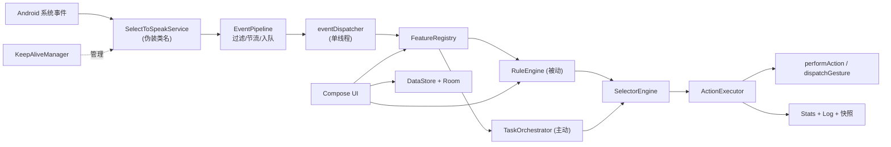
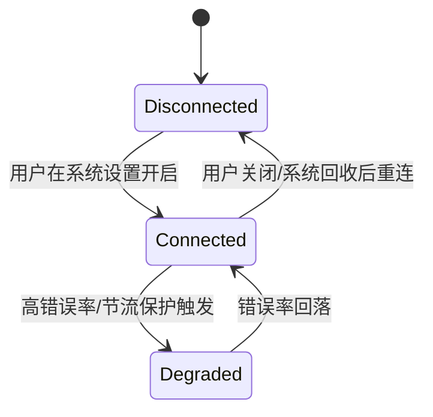
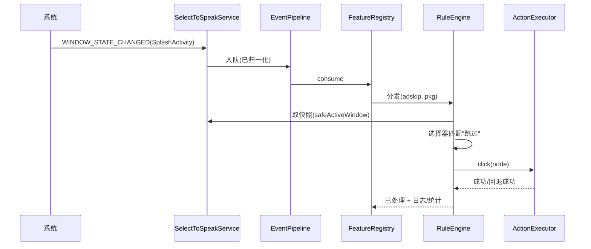
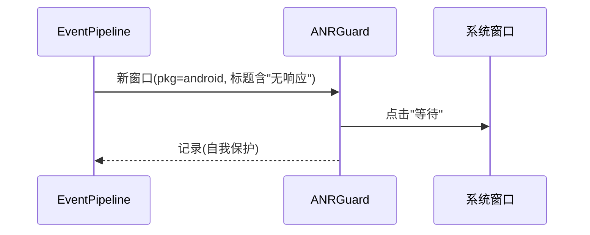

# 工具箱基座与无障碍引擎设计方案

> **文档用途：** 面向技术评审、开发、测试和运维人员的设计说明  
> **功能 ID：** `toolbox-core`  
> **对应需求：** `R-001 ~ R-010`（`README.md §2.1`）  
> **对应实施计划：** [`01-实施计划.md`](01-实施计划.md)  
> **代码基线：** 新建仓库（无历史提交）  
> **设计版本：** `v1.0`  
> **日期：** `2026-10-13`  
> **状态：** `待评审`

---

## 1. 摘要

本项目要做 **wave工具箱**——一个安卓无障碍工具箱：一批互不相关的小功能（跳过开屏广告、清理微信僵尸好友、未来的各类重复操作自动化）共享同一套基于 AccessibilityService 的能力底座。仓库目前零代码，直接开写业务功能会导致每个功能各自为战——2016 年的 InspectWechatFriend 就是教训：硬编码 `Thread.sleep`、Activity 类名与 view-id 散落在 `onAccessibilityEvent` 中，升级即碎。

本方案引入的核心能力是一台**引擎**：把"系统事件 → 界面快照 → 规则/任务匹配 → 动作执行"抽象为可测试的流水线，并以 `ToolFeature` SPI 挂接业务。参考 gkd 的工程实践（单线程三 Dispatcher、100ms 节流、1×1 overlay 保活、规则字段设计）与 worktool 的 ANR 自愈，全部为设计借鉴、不复制代码（许可边界见 D-010）。

关键约束：免 root、零网络权限、纯本地运行；所有匹配逻辑可在 JVM 单测（`NodeView` 抽象），设备只做端到端；引擎与特性单向依赖；**服务组件类名冻结为 Google SelectToSpeak 伪装全限定名（微信空树门禁，D-011）**。

一句话方案：

> 在保留"无障碍服务是唯一注入点"的前提下，通过事件管线 + 双执行层（被动规则引擎 / 主动任务编排）+ Feature SPI，把零散工具收敛为可独立验证的小切片。

---

## 2. 问题定义

### 2.1 业务背景与故障特征

目标用户场景：用户希望"手机自动帮自己做点小事"。以跳过开屏广告为例（arXiv 2609.17316 的故障链）：

```text
用户点击 App 图标
  -> 开屏广告全屏展示（5s 倒计时，含"摇一摇跳转"陷阱）
  -> 用户误触/等待
  -> 延迟进入主功能，甚至被跳转到第三方 App
```

现有方案对比（论文结论）：root/Xposed 门槛高；改包（去广告版）升级即失效；**无障碍方案唯一在全部实测 App 上成功且免 root**，代价是约 1 秒可见延迟与需要维护规则。

### 2.2 当前实现与主要缺口

| 缺口 | 当前行为 | 根因/证据 | 导致的问题 |
|---|---|---|---|
| 无工程 | 空仓库 | `git status` | 无法承载功能 |
| 无事件处理 | — | 李跳跳还原：单类 1586 行混编所有逻辑 | 功能间互相耦合 |
| 无匹配抽象 | — | InspectWechatFriend：`findAccessibilityNodeInfosByViewId` 硬编码 | view-id 随版本漂移即失效 |
| 无任务编排 | — | InspectWechatFriend：`Thread.sleep` 序列 | 时序抖动导致随机失败 |
| 无保活/引导 | — | 李跳跳：前台通知+1×1 悬浮窗+自启 | 服务被回收后用户无感知 |

### 2.3 设计目标

| R-ID | 目标 | 可度量成功标准 |
|---|---|---|
| R-001 | 可构建工程 | `assembleDebug` 成功；安装启动无崩溃 |
| R-003 | 事件管线 | 压测 5 分钟无 ANR；CONTENT_CHANGED 节流 ≤10 次/秒 |
| R-004 | 选择器引擎 | JVM 单测 ≥30 例全绿；解析失败不抛异常 |
| R-005 | 动作执行 | 点击三档回退成功率 ≥95%（手动清单） |
| R-007 | 编排器 | 单测覆盖成功/超时/取消/重试全分支 |
| R-006 | 保活 | 重启 + 锁屏 30 分钟服务在线 |

### 2.4 非目标

- 不实现 JS 脚本引擎（NEXT-001）；不改动 `third_party/`（只读参考）；不在本期做远程订阅（NEXT-005）。

### 2.5 前置假设与约束

| 类型 | 内容 | 验证方式 | 假设失效后的处理 |
|---|---|---|---|
| 技术 | 目标用户 Android 8.0+（minSdk 26） | 安装量分布 | 提升 minSdk |
| 生态 | 微信/主流 App 节点树对无障碍可见 | 竞品（gkd/李跳跳）长期可用 | 引入 OCR 兜底（NEXT-002） |
| 分发 | 侧载为主 | Q-003 | 若上架 Play 则补声明表单 |

---

## 3. 总体设计

### 3.1 设计原则

| 原则 | 含义 | 对实现的约束 |
|---|---|---|
| 逻辑与设备解耦 | 匹配/编排不依赖 Android framework | 必须经 `NodeView`/假事件源注入 |
| 单注入点 | 系统只看到 1 个 Service | 所有特性经 FeatureRegistry 分发 |
| 失败隔离 | 单规则/单步骤/单特性失败不拖垮引擎 | 全链路 try-catch + 状态登记 |
| 默认安全 | 关闭即零副作用；点击优先低风险动作 | 默认 `engine.enabled=true` 但特性默认关 |
| 可观测 | 每个决策可复盘 | 结构化日志 + 快照导出 |

### 3.2 系统架构



架构说明：

- **入口层**：`SelectToSpeakService`（完整伪装类名 `com.google.android.accessibility.selecttospeak.SelectToSpeakService`，D-011）只做：系统契约方法、生命周期、保活挂载、把事件透传给 `EventPipeline`。
- **编排层**：`EventPipeline` 归一化/节流；`FeatureRegistry` 按优先级分发（开关、包名预筛）。
- **核心层**：`RuleEngine`（声明式规则的匹配执行）与 `TaskOrchestrator`（命令式步骤状态机）构成双执行层；共享 `SelectorEngine` 与 `ActionExecutor`。
- **依赖层**：DataStore（设置）、Room（规则/历史/统计）、assets（内置规则）。
- **观测层**：结构化日志、统计、快照导出、通知栏状态。

### 3.3 职责边界

| 模块/层 | 负责 | 不负责 | 依赖 |
|---|---|---|---|
| `SelectToSpeakService`（伪装类名） | 系统契约、生命周期、保活挂载 | 任何匹配/业务逻辑 | EventPipeline |
| `EventPipeline` | 事件过滤/节流/背压/ANR 守卫 | 决策 | — |
| `FeatureRegistry` | 分发、优先级、互斥 | 匹配细节 | SPI |
| `RuleEngine` | 规则查询→匹配→动作 | 跨步状态 | Selector/Action |
| `TaskOrchestrator` | 步骤状态机/进度 | 具体界面知识 | Selector/Action |
| `SelectorEngine` | 解析/匹配/排序（纯 JVM） | 点击 | NodeView |
| `ActionExecutor` | 点击链/手势/冷却/账本 | 决策 | Android framework |
| `KeepAliveManager` | overlay/通知/自启 | — | Android framework |
| `UI` | 配置/日志/检查器 | 直接触碰引擎内部 | ViewModel |

### 3.4 当前链路与目标链路

当前链路（无代码）：系统事件 →（无处可去）。

目标链路：

```text
系统事件
  -> SelectToSpeakService.onAccessibilityEvent（缩放为元数据）
  -> EventPipeline（丢噪声/节流/入队）
  -> FeatureRegistry（包名与开关预筛）
  -> RuleEngine / TaskOrchestrator
  -> SelectorEngine（快照树上匹配）
  -> ActionExecutor（performAction / dispatchGesture）
  -> 日志/统计/通知栏状态
```

---

## 4. 修复方式与修改点

本功能为新功能，本章按"修改点即新建组件"列出：

### 4.1 修复方式概述

| 项 | 内容 |
|---|---|
| 根因 | 无统一无障碍能力层，功能落地即耦合 |
| 修复策略 | 新建引擎与 SPI（见 4.3），业务零改引擎 |
| 保持不变 | `third_party/` 逆向资料与其分析结论 |
| 被否决的替代方案 | fork gkd（GPL 绑定）、内嵌 AutoJs6（重） |

### 4.2 修复前调用链

```text
系统事件 -> （无代码，功能无处承载）
```

### 4.3 修复后调用链

```text
系统事件
  -> SelectToSpeakService
  -> 【MP-001】EventPipeline 过滤/节流
  -> 【MP-002】FeatureRegistry 分发
  -> 【MP-003】RuleEngine/TaskOrchestrator 决策
  -> 【MP-004】SelectorEngine 匹配（NodeView）
  -> 【MP-005】ActionExecutor 执行（三档回退+冷却）
  -> 日志/统计
```

### 4.4 修改点清单

| MP-ID | 文件/符号 | 修改类型 | 修改内容 | 影响的调用链节点 | 关联决策/任务 | 风险 |
|---|---|---|---|---|---|---|
| MP-001 | `core/accessibility/EventPipeline` | 新增 | 过滤/节流/队列/ANR 守卫 | 修复后节点2 | D-006 / T-004 | 中 |
| MP-002 | `core/feature-api/FeatureRegistry` | 新增 | Hilt multibinding 注册与分发 | 节点3 | D-009 / T-010 | 中 |
| MP-003 | `core/rules/RuleEngine`、`core/automation/TaskOrchestrator` | 新增 | 双执行层 | 节点4 | RS-002/004 / T-006,T-008 | 中高 |
| MP-004 | `core/selector/**` | 新增 | NodeView/解析/匹配/排序 | 节点5 | D-003 / T-005 | 中 |
| MP-005 | `core/accessibility/ActionExecutor` | 新增 | 动作执行与防误触 | 节点6 | RS-002 / T-007 | 中 |

---

## 5. 核心组件

### 5.1 `EventPipeline`

职责：把高频、噪声大的系统事件压成稳定、可消费的流。

| 项 | 设计 |
|---|---|
| 输入 | `A11yEvent(type, pkg, cls, time, sourceRef)` |
| 输出 | 过滤后的 `Flow<A11yEvent>`（单消费） |
| 依赖 | `AppDispatchers.engineEvent`（单线程） |
| 状态 | 进程级；节流窗口时间戳 |
| 并发 | 单消费者；`Channel(capacity=64, DROP_OLDEST)` |
| 失败策略 | 管线内部异常只记日志，不重启服务 |
| 测试 | 注入假时钟与假事件源 |

### 5.2 `SelectorEngine`

职责：在快照树上把选择器字符串变为命中节点（可排序、可解释）。

| 项 | 设计 |
|---|---|
| 输入 | `Selector(s)` + `NodeView` 根 |
| 输出 | `List<MatchResult(node, reason, score)>` |
| 依赖 | 无（纯 Kotlin/JVM） |
| 状态 | 解析缓存（LRU map，容量 512） |
| 失败策略 | 语法错误返回 `ParseError`，匹配 0 命中返回空列表 |
| 测试 | JSON fixtures 快照树 + 表驱动用例 |

```kotlin
interface NodeView {
    val text: String?
    val contentDescription: String?
    val viewId: String?      // "pkg:id/name"，仅后缀匹配语义
    val className: String?
    val bounds: Rect
    val isClickable: Boolean
    val isVisible: Boolean
    val isEditable: Boolean
    val isScrollable: Boolean
    val depth: Int
    val drawingOrder: Int?
    val children: List<NodeView>
}

sealed interface SelectorPart { /* [text=], [text^=], [vid=], [class=], '>', '@' ... */ }
```

首期语法（与 gkd 风格对齐、仅取子集）：`[vid=]`、`[text=]`、`[text^=]`、`[text*=]`、`[desc=]`、`[class=]`；组合用空格（后代）与 `>`（子代）；`@` 祖先锚点。命中排序：Y 最小 → 深度最小 → drawingOrder。

### 5.3 `RuleEngine` 与规则模型

职责：声明式"界面上出现 X 就做 Y"。供开屏跳过等被动场景使用。

规则字段沿用 README §6.1 的 JSON5 schema（`id/name/order/activityIds/version*/matches/anyMatches/excludeMatches/action/position/actionCd/actionMaximum/enabled`），并增加 `schemaVersion` 与 `note`。

### 5.4 `TaskOrchestrator`

职责：命令式多步骤流程（微信批检等），事件驱动的步骤推进。

```kotlin
sealed interface Step {
    data class WaitFor(val selector: String, val timeoutMs: Long = 5_000, val failPolicy: FailPolicy = ABORT) : Step
    data class Click(val selector: String, val optional: Boolean = false, val retry: Int = 2) : Step
    data class WaitActivity(val classSuffix: String, val timeoutMs: Long = 10_000) : Step
    data class Scroll(val dir: Dir, val until: Until = UntilNextStable) : Step
    data class ReadText(val selector: String, val into: String) : Step
    data class Back(val times: Int = 1) : Step
    data class Delay(val ms: Long) : Step
    data class OpenApp(val pkg: String) : Step
}

interface TaskExecutor {
    suspend fun run(task: TaskDef): Flow<Progress>
    fun cancel()
}
```

等待条件由事件管线唤醒 + 超时兜底（非 `sleep` 轮询）、每步独立超时/重试/失败策略、同包互斥执行。

### 5.5 `ActionExecutor`

职责：统一执行与防误触。

动作集合：`click`（`performAction(ACTION_CLICK)` → 最近可点击祖先 → `dispatchGesture` 坐标兜底）、`longClick`、`back`（`GLOBAL_ACTION_BACK`）、`scroll`、`positionClick`。
防误触：`actionCd` 冷却、`actionMaximum` 次数（activity 实例内）、编辑框/勾选框/滚动容器过滤、宽 >60% 且无文本节点过滤（李跳跳 `c()` 语义移植）。

### 5.6 `KeepAliveManager`

1×1 透明 `TYPE_ACCESSIBILITY_OVERLAY`（不可触碰）+ FGS(specialUse) 常驻低优先通知（含状态与快捷开关）+ `BOOT_COMPLETED`/`LOCKED_BOOT_COMPLETED` 接收器 + 引导页（受限设置/电池优化/自启白名单）。

---

## 6. 数据模型、接口与核心机制

### 6.1 核心数据模型

```kotlin
@Entity(tableName = "rules")
data class RuleEntity(
    @PrimaryKey val id: String,          // pkg@activity#order
    val pkg: String,
    val groupId: String,
    val json: String,                    // 原始 JSON5 片段（含解析错误时保留）
    val enabled: Boolean,
    val versionCodeMin: Long?, val versionCodeMax: Long?,
    val versionNameMin: String?, val versionNameMax: String?,
    val activityIds: String,             // \n 分隔
    val updatedAt: Long,
)
```

### 6.2 核心规则或算法（匹配决策）

```text
输入: 事件(pkg, activity) + 快照树
  -> 前置: 引擎/特性开关、包名白名单、服务已连接
  -> 规则集 = Room.query(pkg, activity, version)    // 版本/activity 预筛
  -> 逐条规则（order 升序）:
       matches 全部命中 && anyMatches 任一命中(或空) && excludeMatches 全不命中
       -> 命中: 按 score 选最优节点 -> ActionExecutor.perform
       -> 记录日志/统计; 命中一条后是否继续由 group 策略决定
  -> 全不命中: 静默结束
```

### 6.3 数据一致性与并发

- **一致性**：规则导入为事务；统计为 append-only。
- **幂等**：同一节点在冷却窗口内不重复点击。
- **并发控制**：事件/查询/动作三单线程；任务互斥锁（同包）。
- **时间语义**：冷却/节流用单调时钟（`SystemClock.elapsedRealtime`）。

### 6.4 API / 事件 / 外部接口

| 接口 | 输入 | 输出 | 兼容性 | 权限/安全 |
|---|---|---|---|---|
| `ToolFeature.onEvent` | `EventContext` | `Boolean(已处理)` | SPI 带 `spiVersion` | 无网络 |
| `TaskExecutor.run` | `TaskDef` | `Flow<Progress>` | 新增 | 无 |
| 快照导出 | 当前窗口 | JSON 文件 | 新增 | 无（本地） |

---

## 7. 状态机与决策策略

### 7.1 服务生命周期状态机



| 状态 | 含义 | 允许动作 | 退出条件 |
|---|---|---|---|
| `Disconnected` | 未连接 | UI 引导开启 | 系统回调 |
| `Connected` | 正常 | 全功能 | 关闭/回收 |
| `Degraded` | 保护态 | 仅 `WINDOW_STATE_CHANGED`，跳过 CONTENT 洪水 | 错误率<阈值 60s |

### 7.2 决策优先级

| 优先级 | 条件 | 动作 | 原因 |
|---|---|---|---|
| P0 | 引擎关闭/包在黑名单 | 仅日志 | 零副作用 |
| P1 | 主动任务持有该包互斥 | 任务优先，规则暂停 | 避免抢点击 |
| P2 | 规则命中且有冷却余额 | 执行动作 | 正常路径 |
| P3 | 命中但账本耗尽/节流中 | 记录并等待 | 防连点 |

### 7.3 阈值、默认值与依据

| 参数 | 初始值 | 单位 | 依据 | 调整方式 |
|---|---:|---|---|---|
| `contentThrottleMs` | 100 | ms | gkd 实测值 | 配置 |
| 事件队列容量 | 64 | 条 | 估：峰值事件>处理速度，需背压 | 常量 |
| 动作冷却默认 | 500 | ms | 防连点经验值（工程初值） | 规则字段 |
| 点击校验窗口 | 200 | ms | 设备帧延迟量级（工程初值） | 常量 |

---

## 8. 数据流与关键时序

### 8.1 正常流程（被动规则）



### 8.2 异常与恢复（ANR 守卫）



### 8.3 停止、取消或资源释放顺序

```text
服务 onUnbind/onDestroy
  -> 取消任务与事件消费协程
  -> 移除 1×1 overlay
  -> 关闭 FGS 通知
  -> 刷新统计落库
```

---

## 9. 特殊路径与边界场景

| 场景 | 预期行为 | 不允许的行为 | 验证方式 |
|---|---|---|---|
| 首次启用 | 引导页三步 | 直接弹一堆权限 | 手动 |
| 隐私页面（密码框） | 不读取 text 值敏感字段 | 误点密码框 | 手动 |
| 分屏/悬浮窗 | 用 `getWindows()` 全量窗口 | 只看 activeWindow | 手动（模拟器） |
| 横屏 | bounds 按实际坐标 | 硬编码坐标 | 手动 |
| 微信在前台但任务取消 | 任务优雅退出，不动 Activity | 强杀微信 | 单测+手动 |
| 无事件空窗 | 保活心跳仅记录 | 误判服务死亡 | 手动 |

---

## 10. 失效与降级策略

| 异常 | 检测方式 | 处理 | 用户可见结果 | 告警/证据 |
|---|---|---|---|---|
| 服务被回收 | 通知消失/重连回调 | 自动重连+自启 | 通知恢复 | 日志 |
| 事件洪水 | 队列丢弃计数 | 进入 Degraded | 无感 | 统计 |
| 规则全失效 | 命中率为 0 超 24h | 提示"可能升级了" | 首页角标 | 统计 |
| 快照取空 | null 连续 N 次 | 延迟重取 | 无感 | 日志 |

降级原则：安全优先（宁可不点、不误点）；失效保持"旧行为=什么都不做"；只有服务反复掉线需要用户介入（引导页跳转）。

---

## 11. 配置设计

### 11.1 核心配置

```json5
{
  engine: { enabled: true, contentThrottleMs: 100, allowPackages: [] /* 空=全部 */ },
  debug: { snapshotExport: false, verboseLog: false }
}
```

### 11.2 配置语义与校验

| 配置 | 类型 | 默认值 | 语义 | 合法范围 | 动态生效 |
|---|---|---|---|---|---|
| `engine.enabled` | bool | `true` | 引擎总开关 | — | 是 |
| `engine.contentThrottleMs` | int | 100 | CONTENT_CHANGED 节流 | 50~1000 | 是 |
| `engine.allowPackages` | list | 空 | 白名单（空=全部） | — | 是 |

来源优先级：默认值 < DataStore；非法值回退默认并提示。

---

## 12. 可观测性设计

### 12.1 状态快照

```json
{ "engine": { "enabled": true, "state": "Connected", "queueDrop": 0, "throttleSkip": 123, "updatedAt": "RFC3339" } }
```

### 12.2 日志

- 前缀 `Toolbox/`；info=生命周期与命中；warn=降级/失败；debug=原始事件（限频）。
- 结构化字段：`featureId, pkg, activity, ruleId, action, result, durationMs, reason`。

### 12.3 指标

| 指标 | 类型 | 标签 | 用途 |
|---|---|---|---|
| `actions_total` | Counter | featureId/result | 成败统计 |
| `action_latency_ms` | Histogram | featureId | 性能 |
| `queue_drop_total` | Counter | — | 背压预警 |

---

## 13. 兼容性与安全边界

### 13.1 兼容性

| 边界 | 设计 | 验证 |
|---|---|---|
| Android 版本 | API 分支封装（`isAccessibilityTool`、受限设置、FGS 类型） | 真机矩阵 |
| 规则 schema | `schemaVersion` + 未知字段忽略 | 单测 |
| SPI | `spiVersion` + 未知 action no-op | 单测 |
| 服务组件类名 | 冻结为伪装全限定名（D-011，类真移包）；变更需重跑 C-005 冒烟 | C-005 |

### 13.2 安全边界

| 风险面 | 设计 |
|---|---|
| 隐私 | 零网络；快照默认不落盘（debug 才导出）；密码框文本按 API 语义处理 |
| 权限 | 仅无障碍 + POST_NOTIFICATIONS + RECEIVE_BOOT_COMPLETED + FGS |
| 滥用 | 冷却/次数防止连点；任务互斥防止多特性抢点击 |
| 供应链 | 全部依赖锁定版本；许可证白名单（Apache/MIT；GPL 仅设计借鉴） |

---

## 14. 方案对比与决策记录

| 方案 | 优点 | 缺点/风险 | 适用条件 | 结论 |
|---|---|---|---|---|
| 自研引擎 | 可控可测无绑定 | 工期 | 本仓库 | 推荐 |
| fork gkd | 起点高 | GPL、上游节奏 | 快速起量 | 备选 |
| 内嵌 AutoJs6 | 生态大 | 体积/无类型 | 脚本化需求强 | 备选 |
| 纯 UiAutomator | 测试完备 | 需 adb 常驻 | 开发者用户 | 拒绝 |

关键决策见 `01 §4.2`（D-001 ~ D-011）。

---

## 15. 验证方案

### 15.1 单元测试

1. 选择器：正例/反例/边界（Unicode、空树、深树、重复文本）。
2. 规则：解析、版本区间、坏规则隔离、activity 匹配。
3. 编排：成功/超时/取消/重试/失败策略矩阵。
4. 管线：节流窗口、丢弃策略、ANR 特征识别。
5. 账本：冷却、次数、activity 重启重置。

### 15.2 集成验证（设备）

1. 系统设置界面（无 view-id 侧载场景）：关键词点击。
2. 微信：友商规则（跳过启动广告）+ 任务编排冒烟。
3. 悬挂/降级：连续滑动、快速切换 App。

### 15.3 端到端与故障注入

| 场景 | 注入方式 | 验证点 | 成功标准 |
|---|---|---|---|
| 事件洪水 | 高速滑动 5 分钟 | 无 ANR、丢弃计数>0 且可控 | 中文滑顺、服务在线 |
| 服务回收 | `adb shell am force-stop` 后再开 | 自动恢复 | 通知恢复 |
| 规则损坏 | 导入坏 JSON5 | 隔离+提示 | 其余规则工作 |
| 微信空树门禁 | 开启服务后进入微信主界面 dump | 节点树非空、根 cls 非 null（对照 407B 空树特征） | `C-005` PASS |

### 15.4 验收映射

| AC-ID | 覆盖需求 | 测试/命令 | 证据位置 |
|---|---|---|---|
| AC-001 | R-001 | `C-001` | `02` |
| AC-003 | R-004 | `C-002` | `02` |
| AC-005 | R-007 | `C-003` | `02` |
| AC-002/004/006/007 | R-002/005/006/008 | 手动清单 | `02` |

---

## 16. 灰度与回滚

### 16.1 发布顺序

```text
开发自用（默认特性关）
  -> 3 机型内测（Android 10/13/15）
  -> 好友小范围侧载
  -> 公开发布（GitHub Release）
```

| 阶段 | 重点观察 | 放量条件 | 停止条件 |
|---|---|---|---|
| 内测 | 崩溃/耗电/服务掉线 | 7 天无 P0 | 任意 P0 |
| 小范围 | 误点反馈 | 误点率<5% | 出现批量误点 |

### 16.2 回滚

首选：设置页关 `engine.enabled`（零风险隔离）；其次回装旧 APK（不涉及数据迁移，Room 有降级策略）。不可逆变更：无。

---

## 17. 风险与缓解

| RK-ID | 风险 | 级别 | 触发信号 | 缓解措施 | 回滚/应急 |
|---|---|---|---|---|---|
| RK-001 | OEM 保活失败 | 高 | 掉线日志/用户反馈 | 三机制+引导 | 引导页重开 |
| RK-002 | 受限设置阻断 | 高 | 开启页灰色 | 引导检测分支 | 图文说明 |
| RK-003 | 事件洪水耗电 | 中 | 电池统计 | 节流/白名单 | 调参/降级 |
| RK-004 | 上游规则漂移 | 中 | 命中率下降 | fixtures 回归+版本字段 | 规则更新 |
| RK-005 | GPL 混入 | 低 | 代码审查 | D-010 检查 | 改许可或重写 |
| RK-006 | 微信空树门禁回归 | 低 | 类名/Manifest 变更 | D-011 冻结 + C-005 冒烟；407B 特征定位 | 核对组件名并复测 |

---

## 18. 评审重点

1. 事件管线边界（丢弃策略是否可能丢关键事件？）——评审关注：`WINDOW_STATE_CHANGED` 永丢策略。
2. 账本与互斥语义是否唯一明确——评审关注：任务与规则并发时的优先级。
3. `NodeView` 适配是否覆盖"不可见但可点"的节点语义。
4. 保活三机制是否可能互相干扰（overlay 是否抢焦点）。
5. SPI 版本化與未来兼容。

评审结论：`待评审`
未决事项：`无（Q-001~003 已于 2026-10-13 决议）`

---

## 19. 实施与验收关系

以 `01-实施计划.md` 为准执行；证据记录在 `02`；复盘在 `03`。一致性要求：本文 R/D/MP/AC/RK ID 与其余文档一致。

---

## 20. 参考资料

### 20.1 当前系统证据

- `third_party/litiaotiao_analysis/李跳跳_完整源码还原报告.md`：引擎语义（关键词任务/树路径/过滤/保活）第一手参考。
- `third_party/litiaotiao_analysis/source/sources/hello/litiaotiao/app/LttService.java`：还原源码。
- `wavexzore-ledger`（本地姊妹项目）：D-014/PIT-004——微信 8.0.78 空树门禁实证（旧类名 407B vs 伪装名 ≈90KB A/B 对照；阿柴记账/小米钱包同款伪装惯例）。

### 20.2 官方文档与标准

- [Create an accessibility service](https://developer.android.com/guide/topics/ui/accessibility/service)：配置 XML/手势/全局动作契约。
- [Foreground service types #special-use](https://developer.android.com/develop/background-work/services/fg-service-types#special-use)：FGS 类型与 property 声明。
- [Android 13 behavior changes（受限设置）](https://developer.android.com/about/versions/13/behavior-changes-all#restricted_settings)：侧载应用无障碍默认禁用。
- [AccessibilityService 参考](https://developer.android.com/reference/android/accessibilityservice/AccessibilityService)。

### 20.3 论文、标准与开源实现

- [Can We Stop The Ads? (arXiv 2609.17316, 2026)](https://arxiv.org/abs/2609.17316)：108 种广告拦截方案评估；无障碍方案唯一全通过。
- [PUMA (MobiSys 2014)](https://www.microsoft.com/en-us/research/publication/puma-programmable-ui-automation-for-large-scale-dynamic-analysis-of-mobile-apps/)：可编程 UI 自动化，探索与分析分离。
- [Mobile-Agent (arXiv 2401.16158)](https://arxiv.org/abs/2401.16158)：视觉代理未来方向。
- [gkd-kit/gkd](https://github.com/gkd-kit/gkd)（GPL-3.0）：引擎架构、选择器、保活设计借鉴；不复制代码。
- [gallonyin/worktool](https://github.com/gallonyin/worktool)（Apache-2.0）：ANR 自愈、等待与重试。
- [lisonge/kotlin-json5](https://github.com/lisonge/kotlin-json5)（Apache-2.0）：`li.songe:json5` 依赖。
- [zfdang/Android-Touch-Helper](https://github.com/zfdang/Android-Touch-Helper)：三档匹配与零网络隐私定位。

---

## 21. 变更日志

| 时间 | 版本 | 变更 | 作者/Agent | 证据 |
|---|---|---|---|---|
| 2026-10-13 | v1.0 | 创建设计方案 | opencode agent | 调研一手资料（见 §20） |
| 2026-10-13 | v1.1 | 服务组件类名固定伪装 SelectToSpeak（D-011/RK-006/兼容与冒烟）；A11yService 更名 | opencode agent | ledger D-014/PIT-004 |
