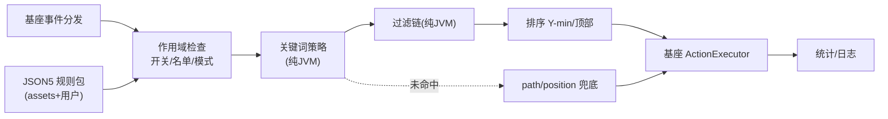
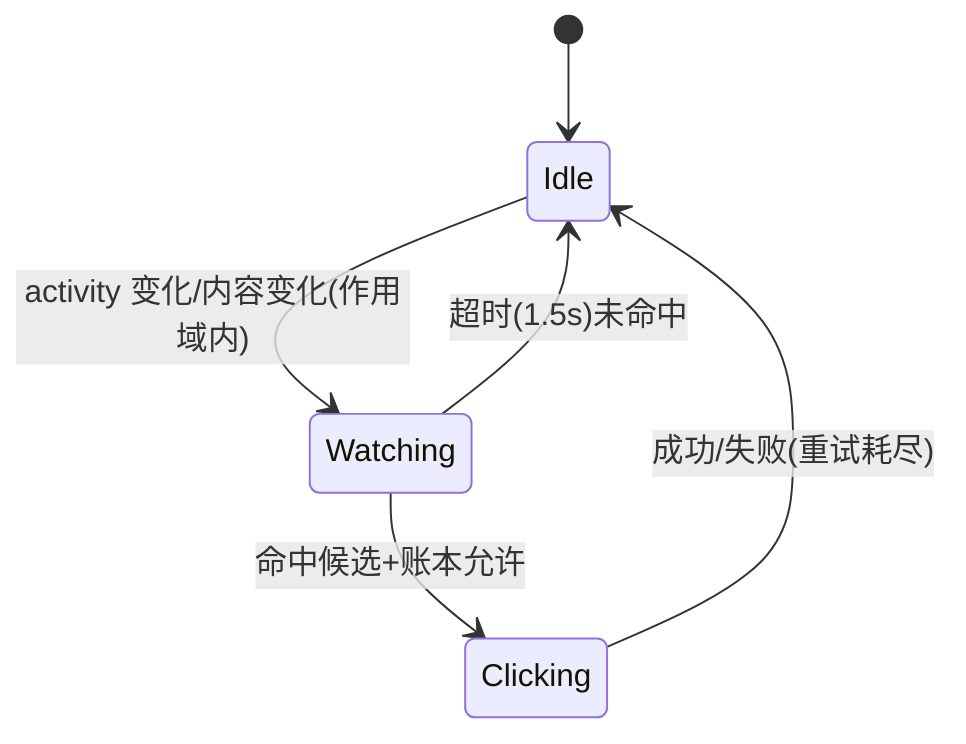
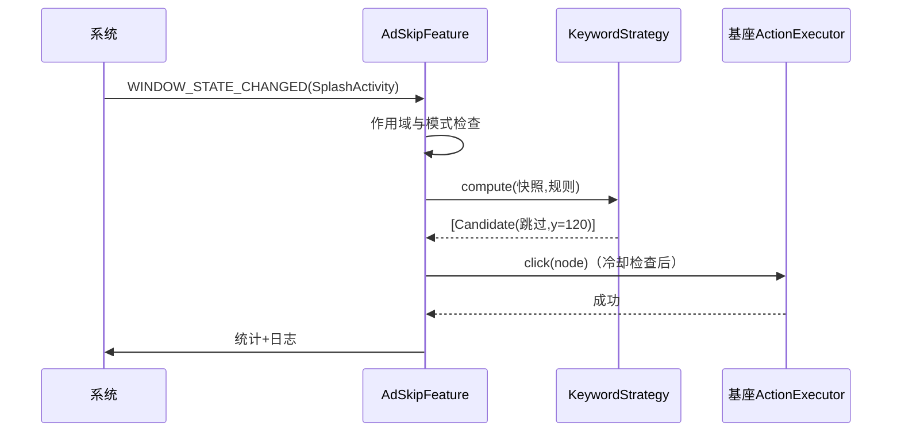

# 开屏广告自动跳过设计方案

> **文档用途：** 面向技术评审、开发、测试人员的设计说明  
> **功能 ID：** `splash-ad-skipper`  
> **对应需求：** `R-001 ~ R-008`（`README.md §2.1`）  
> **对应实施计划：** [`01-实施计划.md`](01-实施计划.md)  
> **代码基线：** 基座 v1.0 计划（未实施）  
> **设计版本：** `v1.0`  
> **日期：** `2026-10-13`  
> **状态：** `待评审`

---

## 1. 摘要

"开屏广告跳过"是工具箱第一个被动规则特性：用户在任意 App 冷启动时，开屏广告展示 3~5 秒，本特性在窗口出现约 1 秒内模拟点击"跳过"。可行性有双重证据：arXiv 2609.17316（2026）对 11 个工具的实测中，无障碍方案是唯一在 10/10 应用全部成功且免 root 的；李跳跳 2.2 的还原源码给出了可直接移植的完整语义（关键词、过滤、排序、重试预算）。

本设计把"点哪个按钮"的策略与"如何点"的执行完全分离：策略（关键词优先级/过滤/排序/延迟）是纯 JVM 可测组件；执行复用基座 `ActionExecutor`；规则以 JSON5 承载，可按 App/Activity/版本约束，并保留三条兜底路径（view-id、树路径、坐标）。

一句话方案：

> 复用基座引擎，将李跳跳经过两年验证的"关键词→过滤→Y 最小→可点击祖先"语义 Kotlin 化、规则化、可回归化，默认保守（splash 模式 + 防误点过滤），用户可逐级放宽。

---

## 2. 问题定义

### 2.1 业务背景与故障特征

```text
用户冷启动 App
  -> 开屏广告 3~5s（倒计时、"跳过"小字/图标、店铺类可"摇一摇"跳转）
  -> 用户等待或误触进入广告二跳
  -> 主界面延迟，甚者被拉起第三方 App
```

### 2.2 当前实现与主要缺口

| 缺口 | 当前行为 | 根因/证据 | 导致的问题 |
|---|---|---|---|
| 无特性实现 | — | 仓库零代码 | 功能缺失 |
| 关键词语义未固化 | 李跳跳源码为 Java 硬编码 | `LttService.java` `e` 类 | 移植需系统性对照，避免遗漏过滤 |
| 无规则体系 | 李跳跳用 MMKV+内置 merge | 还原报告 §4 | 无版本约束、无单测 |

### 2.3 设计目标

| R-ID | 目标 | 可度量成功标准 |
|---|---|---|
| R-001 | 关键词跳过 | 10 应用 ≥8 成功；耗时中位数 <1.5s |
| R-006 | 防误触 | 首批实测误点 ≤2 例，且均可由配置消除 |
| R-008 | 可测 | JVM fixtures ≥20 例全绿 |

### 2.4 非目标

- 不做图像识别（NEXT-202）；不拦截网络请求（NEXT-204）；不处理"摇一摇"（NEXT-201）。

### 2.5 前置假设与约束

| 类型 | 内容 | 验证方式 | 假设失效后处理 |
|---|---|---|---|
| 生态 | 主流 App 开屏按钮有可点节点（文本/desc/可点容器） | 快照抽查 20 应用 | path/position 兜底 |
| 基座 | 规则/动作/SPI 按计划交付 | 基座任务验收 | 协商回写基座计划 |

---

## 3. 总体设计

### 3.1 设计原则

| 原则 | 约束 |
|---|---|
| 保守优先 | 过滤先于匹配；默认只 interplay splash 场景 |
| 提示可解释 | 每次跳过写入日志（命中规则/节点/耗时） |
| 三层兜底 | 关键词 → path → position，脆弱性递增执行顺延 |
| 规则可回归 | 一切规则以真机快照 fixtures 有测试 |

### 3.2 系统架构



### 3.3 职责边界

| 模块 | 负责 | 不负责 |
|---|---|---|
| `AdSkipFeature` | 事件接入、作用域、模式 | 匹配细节 |
| `KeywordStrategy` | 关键词表/匹配/排序/延迟 | 点击执行 |
| `RulePackLoader` | 规则装载/覆盖/导入导出 | 匹配 |
| 基座组件 | 事件/快照/动作/账本 | 业务 |

### 3.4 目标链路

```text
事件 → 作用域（开/关/名单/模式） → 规则组查询
  → 关键词命中 → 过滤 → 排序 → 点击（可点击祖先→坐标）
  → 未命中且规则含 path/position → 兜底 → 账本 → 统计
```

---

## 4. 修改点（新增组件）

| MP-ID | 文件/符号 | 类型 | 内容 | 关联 | 风险 |
|---|---|---|---|---|---|
| MP-101 | `feature/adskip/AdSkipFeature` | 新增 | SPI 接入与作用域 | D-105/T-001 | 低 |
| MP-102 | `feature/adskip/KeywordStrategy` | 新增 | 关键词/过滤/排序/延迟 | D-102~104/T-002 | 中 |
| MP-103 | `feature/adskip/RulePackLoader` | 新增 | 规则装载与导入导出 | T-003 | 中 |
| MP-104 | `assets/rules/adskip/*.json5` | 新增 | 内置规则集 | T-006 | 中 |
| MP-105 | `feature/adskip/PathPositionStrategy` | 新增 | 兜底执行 | D-106/T-005 | 中 |

---

## 5. 核心组件

### 5.1 `KeywordStrategy`（纯 JVM）

| 项 | 设计 |
|---|---|
| 输入 | `NodeView` 快照 + 关键词表 + 规则约束 |
| 输出 | `Candidate(node, score, reason)` 有序列表（空=未命中） |
| 状态 | 无状态（延迟窗口由 Feature 层） |
| 并发 | eventDispatcher 单线程内调用 |
| 失败 | 任何异常→空列表 + 日志 |
| 测试 | 快照 fixtures 表驱动 |

默认关键词（顺序即优先级）：`跳过`、`关闭`、`×`、`我知道了`、`跳过广告`、`id:skip`（viewId 含 skip）、`desc:跳过`。
命中规则：`text/desc` 包含关键词且长度 ≤6（中文计 6 字）；排除 `excludeMatches`。

过滤链（李跳跳 `c()` 移植）：
1. `isEditable` 或 `isCheckable` 排除；
2. `isScrollable` 容器且无 text 排除；
3. 宽度 > 60% 屏宽且 text 为空排除；
4. `!isVisible` 排除（可配）。

排序：`score = (y 归一化 × 0.7) + (深度 × 0.3)`；同分取 `drawingOrder` 大者（更靠上层）。

### 5.2 `PathPositionStrategy`

- `path`：规则数组 `[{drawingOrder, childCount}...]` BFS 匹配（李跳跳 `b` 类语义）。
- `position`：`{x, y}` px 或 `%`；点击用 `dispatchGesture`。
- 执行顺延：关键词未命中才执行；`path` 先于 `position`。

---

## 6. 数据模型与核心机制

### 6.1 规则模型

见 `README.md §6.1`；扩展字段：`mode: splash|any`、`path`、`position`、`delayOverrideMs`、`excludeMatches`。

### 6.2 匹配算法

```text
输入: 事件 + 快照
  -> 规则预筛（pkg/activity/version/enabled/模式）
  -> 对每条规则按 order：
       candidates = KeywordStrategy.compute(...)
       if 命中: 取 top1 -> 冷却/限次检查(基座账本) -> 点击
       else if 规则含 path/position: 兜底 -> 点击
  -> 命中后 break（或 group.continue 语义）
```

### 6.3 一致性与并发

- 单事件单点击；同一节点 800ms 冷却（默认，规则可覆写）。
- 与微信批检任务互斥由基座保证（任务优先）。

---

## 7. 状态机与决策策略



决策优先级：

| 优先级 | 条件 | 动作 | 原因 |
|---|---|---|---|
| P0 | 特性关闭/名单外 | 跳过 | 零副作用 |
| P1 | 微信任务持有互斥 | 跳过 | 不抢点击 |
| P2 | 关键词命中+账本允许 | 点击 top1 | 正常 |
| P3 | 仅 path/position 命中 | 兜底点击 | 次优 |
| P4 | 冷却中 | 记录等待 | 防连点 |

参数依据：年轻弹窗延迟 150ms（工程初值，真机实测校准）；重试预算 3 次/200ms（李跳跳 delay 199ms 同量级）。

---

## 8. 数据流与关键时序



异常路径：快照空→200ms 内重取（≤3 次）；点击失败→祖先回退→坐标兜底→记录失败。

---

## 9. 边界场景

| 场景 | 预期 | 不允许 | 验证 |
|---|---|---|---|
| 开屏即登录页 | 不点"跳过登录" | 误点 | exclude 单测 |
| 双"跳过"（真实广告+系统） | 点 Y 更小/更上层 | 随机 | 排序单测 |
| 开屏无跳过按钮（部分 App） | 1.5s 后放弃 | 乱点 | 手动 |
| 分屏/画中画 | 只作用 activeWindow | 点背景窗 | 手动 |
| 快速连开两个 App | 各自独立处理 | 串扰 | 手动 |

---

## 10. 失效与降级

| 异常 | 检测 | 处理 | 可见结果 |
|---|---|---|---|
| 规则全失效 | 24h 命中率 0 | 首页提示 | 提示条 |
| 快照异常 | null 连续 N 次 | 延迟重试 | 无感 |
| 误点反馈 | 用户标记 | 生成"待修快照"导出 | 规则迭代 |

---

## 11. 配置设计

| 配置 | 类型 | 默认 | 语义 | 动态 |
|---|---|---|---|---|
| `adskip.enabled` | bool | true | 总开关 | 是 |
| `adskip.mode` | enum | splash | 作用模式 | 是 |
| `adskip.perApp` | map | — | 单 App 开关 | 是 |
| `adskip.keywords.extra` | list | [] | 追加关键词 | 是 |
| `adskip.popupDelayMs` | int | 150 | 年轻弹窗延迟 | 是 |

非法值回退默认；来源优先级：默认 < DataStore < 每次任务显式参数。

---

## 12. 可观测性

- 日志：`Adskip/hit rule=... node=... y=... costMs=...`；`Adskip/miss`（debug 限频）。
- 统计：`skips_total{app}`、`skip_latency_ms`、`skip_failed_total`。

---

## 13. 兼容性与安全边界

| 边界 | 设计 | 验证 |
|---|---|---|
| 规则 schema | schemaVersion；未知字段忽略 | 单测 |
| 版本漂移 | versionName.min/max + fixtures | 回归 |
| 隐私 | 零网络；快照本地 | 审查 |
| 权限 | 复用基座，无新增 | manifest 检查 |
| 服务组件类名 | 冻结为伪装全限定名（基座 D-011） | `C-005` 空树冒烟 |

---

## 14. 方案对比与决策记录

| 方案 | 优点 | 缺点 | 结论 |
|---|---|---|---|
| 关键词为主+规则兜底 | 抗改版、实测有效 | 少量文本依赖 | 推荐 |
| 纯 view-id 规则 | 精确 | 漂移频繁 | 辅 |
| 纯坐标 | 简单 | 屏幕碎片化 | 兜底 |
| 图像识别 | 最强 | 重 | 后续 |

关联决策 D-101 ~ D-107（`01 §4.2`）。

---

## 15. 验证方案

1. 单测：关键词正/反/长度/Unicode；过滤各条件；排序；path/position；账本。
2. 快照回归：20 真实树 fixtures。
3. 手动：10 应用清单（成功率/耗时/误点记录）。
4. 边界：登录页、双跳过、无按钮、分屏。

验收映射见 `01 §9` 与 `02 §5`。

---

## 16. 灰度与回滚

默认开启但自测通过后才发内测；误点集中于某 App 时走"单 App 关闭"热回滚。不可逆变更：无。

---

## 17. 风险与缓解

| RK-ID | 风险 | 级别 | 信号 | 缓解 | 回滚 |
|---|---|---|---|---|---|
| RK-101 | 误点 | 中 | 用户反馈 | 过滤/冷却/名单 | 单 App 关 |
| RK-102 | 漂移 | 高 | 命中率下降 | fixtures/版本 | 规则回滚 |
| RK-103 | 过早点 | 中 | 二跳率 | 延迟参数 | 调参 |

---

## 18. 评审重点

1. 过滤链是否遗漏新误点形态（建议评审时对照真实快照集）。
2. `splash` 与 `any` 的模式判定是否清晰无歧义。
3. 与微信任务互斥的边界（任务进行中后台其他 App 开屏）。
4. 默认开启策略是否接受（Q-102）。

评审结论：`待评审`；未决：`无（Q-101/102 已于 2026-10-13 决议）`。

---

## 19. 实施与验收关系

以 `01` 执行、`02` 取证、`03` 复盘；ID 一致。

---

## 20. 参考资料

### 20.1 当前系统证据

- `third_party/litiaotiao_analysis/source/sources/hello/litiaotiao/app/LttService.java`：`e`(SkipTask2)/`c`/`b`/`d` 语义蓝本。
- `third_party/litiaotiao_analysis/李跳跳_完整源码还原报告.md`：§3/§5 字段与机制。

### 20.2 官方文档

- [Create an accessibility service](https://developer.android.com/guide/topics/ui/accessibility/service)
- [AccessibilityServiceInfo](https://developer.android.com/reference/android/accessibilityservice/AccessibilityServiceInfo)
- [Android 13 restricted settings](https://developer.android.com/about/versions/13/behavior-changes-all#restricted_settings)

### 20.3 论文与开源实现

- [Can We Stop The Ads? (arXiv 2609.17316, 2026)](https://arxiv.org/abs/2609.17316)：唯一全通过的方案是无障碍方案。
- [gkd-kit/gkd](https://github.com/gkd-kit/gkd)（GPL-3.0，设计借鉴）
- [zfdang/Android-Touch-Helper](https://github.com/zfdang/Android-Touch-Helper)（三档策略）
- [李跳跳（闭源，经本地还原）](https://www.litiaotiao.com)

---

## 21. 变更日志

| 时间 | 版本 | 变更 | 作者 | 证据 |
|---|---|---|---|---|
| 2026-10-13 | v1.0 | 初始设计 | opencode agent | 本地还原源码 + 论文 + 官方文档 |
| 2026-10-13 | v1.1 | 补微信空树门禁依赖（服务伪装类名，基座 D-011） | opencode agent | ledger D-014/PIT-004 |
