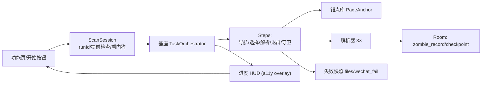
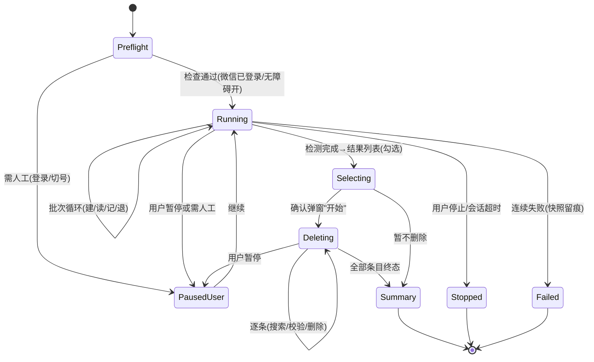
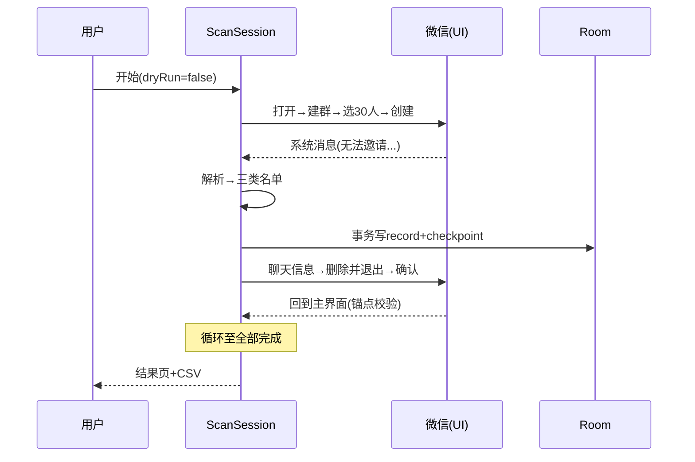
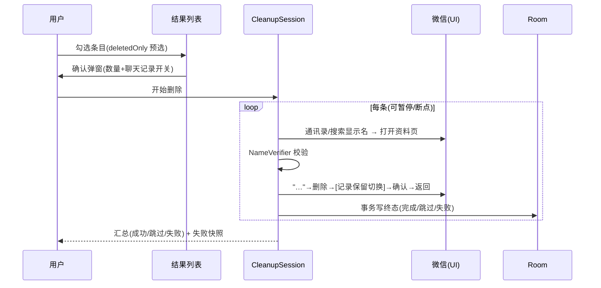

# 微信僵尸好友检测与清理设计方案

> **文档用途：** 面向技术评审、开发、测试人员的设计说明  
> **功能 ID：** `wechat-zombie-cleaner`  
> **对应需求：** `R-001 ~ R-008`（`README.md §2.1`）  
> **对应实施计划：** [`01-实施计划.md`](01-实施计划.md)  
> **代码基线：** 基座 v1.0 计划（未实施）  
> **设计版本：** `v1.0`  
> **日期：** `2026-10-13`  
> **状态：** `待评审`

---

## 1. 摘要

微信用户常见的"僵尸好友"（删了你/拉黑你/封号）无法由通讯录感知。市面工具多依赖 PC 协议（wxpy/网页协议，要求老号）或 iPad 协议（不开放），而"拉群法"利用微信官方功能即可零打扰检测：建 ≤40 人小群时对方无通知，微信会在群内返回三类系统消息，分别对应"已删除/被拉黑/封禁"。`wlj32011/InspectWechatFriend` 在 2016 年已证明该流程可被无障碍服务全自动化（300 好友 3 分钟），但实现脆弱（硬编码 sleep、view-id 表、单文案解析）。

本方案用基座编排器将其重写为**事件驱动状态机**：文本锚点优先、稳定哈希判尾、三类锚点解析、断点恢复、进度 HUD、自愈与失败快照。全部操作等效人工点击，无 hook、无协议注入，账号风险与人工操作等同。

一句话方案：

> 用户点"开始检测"：自动循环"建 30 人群 → 读微信返回 → 记名单 → 解散群"，全程可暂停，产出可导出名单；随后在结果列表勾选 → 确认弹窗 → 自动逐条删除选中用户（幂等、断点）。

流程锚点：**识别 → 列表 → 弹窗选择 → 点击删除 → 删除选中用户**。

---

## 2. 问题定义

### 2.1 业务背景与故障特征

```text
好友 A 删除了用户
  -> 用户本地通讯录无感知（朋友圈状态不可靠）
  -> 发消息才发现"对方开启了朋友验证"（打扰+滞后）
```

行业方案谱系：PC 协议（老号限制）→ iPad 协议（闭源）→ 消息群发（打扰）→ 拉群法（官方、零扰）→ 转账法（官方、单检）。本方案取"拉群法为主"。

### 2.2 当前实现与主要缺口

| 缺口 | 当前行为 | 根因/证据 | 导致的问题 |
|---|---|---|---|
| 无可运行实现 | — | 仓库零代码 | 功能缺失 |
| 参考实现脆弱 | 2016 版硬编码 4 个 Activity 类名 + `Thread.sleep(1000)` ×多处 + 单文案 | `InspectWechatFriendService.java` | 微信改版即失效 |
| 无断点 | 中断白干 | 2016 版内存态 | 300 好友流程长 |
| 无进度 | 用户不知进行到哪 | 2016 版仅 Toast | 体验差 |

### 2.3 设计目标

| R-ID | 目标 | 可度量成功标准 |
|---|---|---|
| R-002 | 批检完整 | 100+ 好友一轮完成无人工干预 |
| R-003 | 解析正确 | ≥6 真实样本全绿；人工抽查一致 |
| R-004 | 清理干净 | 5 连续批无残留群 |
| R-006 | 可恢复 | 任意步中断后从断点续 |
| R-005 | 自愈 | 注入清单全部恢复或优雅失败 |

### 2.4 非目标

- 不做转账法复检（NEXT-301）、消息群发（NEXT-303）、自动加回（NEXT-302）、英文版（NEXT-304）。

### 2.5 前置假设与约束

| 类型 | 内容 | 验证方式 | 假设失效后处理 |
|---|---|---|---|
| 生态 | <40 人建群对方无提示 | 权威资料 + 抽样回访 | 降低批量 |
| 技术 | 微信关键界面节点对 a11y 可见且文本可控 | 真机快照（T-002） | view-id/坐标兜底 |
| 业务 | 用户接受"群短暂存在后解散" | 文档说明 | dry-run/保留群选项 |
| 技术 | 微信节点树对伪装服务类名可见（基座 D-011） | C-205 空树预检 | 空树时先核对服务组件全限定名 |

---

## 3. 总体设计

### 3.1 设计原则

| 原则 | 约束 |
|---|---|
| 官方功能等效 | 只点微信 UI，不 hook/不改包 |
| 锚点>结构 | 文本优先，view-id 仅作提示 |
| 每步可等待 | 无裸 sleep，全部 WaitFor 条件 |
| 证据留痕 | 每批名单 + 原始消息 + 失败快照 |
| 安全默认 | 默认删群；批量保守；随时可停 |

### 3.2 系统架构



架构说明：`ScanSession` 是会话边界（前置检查、看门狗、暂停/停止信号）；一切窗口操作经基座编排器与锚点库；解析器纯函数可在 JVM 单测；HUD 与快照是观测面。

### 3.3 职责边界

| 模块 | 负责 | 不负责 |
|---|---|---|
| `ScanSession` | 会话/前置检查/超时/停止语义 | 页面细节 |
| `Navigator/Anchor` | 页面识别与可达性 | 业务数据 |
| `Steps` | 建群/选择/解析/退群 | 通用动作（基座） |
| `Parsers` | 消息→(kind, names) | 存储 |
| `HudController` | 展示与控制信号 | 流程控制 |

### 3.4 目标链路

见 `01 §4.1`。核心循环：

```text
建群(30) → 读三类系统消息 → 持久化 → 退群 → 校验主界面 → 下一批
```

---

## 4. 修改点（新增组件）

| MP-ID | 文件/符号 | 类型 | 内容 | 关联 | 风险 |
|---|---|---|---|---|---|
| MP-201 | `feature/wechat/ScanSession` | 新增 | 会话/检查/看门狗 | D-208/T-001 | 低 |
| MP-202 | `feature/wechat/anchors/**` | 新增 | 页面锚点库 | D-202/T-002 | 中 |
| MP-203 | `feature/wechat/task/SelectContactsStep` | 新增 | 滚动/去重/判尾 | D-203/T-003 | 中高 |
| MP-204 | `feature/wechat/parser/**` | 新增 | 三解析器 | D-204/T-004 | 中 |
| MP-205 | `feature/wechat/task/LeaveGroupStep` | 新增 | 退群流程 | T-005 | 中 |
| MP-206 | `feature/wechat/hud/**` | 新增 | overlay HUD | D-206/T-006 | 低 |
| MP-207 | `feature/wechat/recovery/**` | 新增 | 自愈+快照 | D-207(见01)/T-008 | 中 |
| MP-208 | `feature/wechat/ui/results/**` | 新增 | 结果多选列表 + 确认弹窗 | D-211/T-011 | 低 |
| MP-209 | `feature/wechat/task/DeleteFriendsStep` | 新增 | 搜索/校验/删除执行 | D-209/D-210/T-012 | 中高 |
| MP-210 | `feature/wechat/verify/NameVerifier` | 新增 | 资料页名称二次校验 | D-209/T-012 | 中 |

---

## 5. 核心组件

### 5.1 `ScanSession`

| 项 | 设计 |
|---|---|
| 输入 | 用户点击开始；配置（批量/dryRun/HUD） |
| 输出 | `StateFlow<ScanState>`（进度/暂停/完成/失败） |
| 依赖 | 基座编排器、Room、HUD |
| 生命周期 | 创建→预检→运行→(暂停/恢复)*→完成/停止→释放 |
| 失败策略 | 单批失败：快照+重试 1 次；仍失败→优雅停止保留断点 |
| 超时 | 单步默认 8~15s；会话 15min（可配） |

### 5.2 `PageAnchor`（锚点库）

锚点=「其一命中即页面可达」的文本/desc 包含断言集合（每页 ≥2 条互相独立）：

| 页面 | 锚点（示例） | 反例排除 |
|---|---|---|
| Main | desc~"更多" ∨ tab"微信" | "选择联系人" |
| CreateMenu | "发起群聊" | — |
| SelectContact | "选择联系人" ∨ "完成(" | "聊天信息" |
| Chat | 输入框 desc~"输入" ∨ 消息容器含"无法邀请" | — |
| ChatInfo | "聊天信息" ∨ "群聊名称" | — |
| ConfirmDialog | "离开群聊" ∨ "确定" | — |

### 5.3 `SelectContactsStep`（最复杂步骤）

```text
与 UI 状态解耦：对"可见候选集合"操作（快照转换为 NodeView）
loop:
  candidates = 可见行(可点/checkable) - 已处理集合 - 已勾选
  for c in candidates: if 已满 batch -> break; click(c); 记录昵称
  if 已满 batch -> 点 完成/确定; return
  scrollForward
  if visibleNamesHash 连续2次不变 -> 到底 -> 点 完成/确定; return
```

判尾哈希：主列表项昵称集合排序后 SHA-1（剥离顶部"已选"网格与 A/B 排序头）。

### 5.4 解析器（纯函数）

```kotlin
sealed interface Hit { val raw: String; val names: List<String> }
data class Deleted(raw, names) : Hit    // 锚: "无法邀请未添加你为好友"
data class Blocked(raw, names) : Hit    // 锚: "拒绝加入群聊"
data class Banned(raw, names)  : Hit    // 锚: "违反用户行为规范"

// 名字提取（宽松、原文留档）：
// Deleted: 取 "请先向" 与 "发送朋友验证申请" 之间，按 "、" 切分
// Blocked: 取 "拒绝加入群聊" 之前，剥离 "你邀请/邀请" 前缀，按 "、" 切分
// Banned: 取 "违反用户行为规范" 之前同理；并兼容单名消息
```

兼容"进/进去"漂移：锚点取最短稳定片段；解析失败→原文归档计数。

### 5.5 `HudController`

- overlay：`TYPE_ACCESSIBILITY_OVERLAY`、`FLAG_NOT_FOCUSABLE|FLAG_NOT_TOUCH_MODAL`、位于左上状态区下方。
- 内容：`已检 63/320 · 命中 5`＋[暂停][停止] 小按钮；dry-run 徽标。
- 交互只发信号给 `ScanSession`，不直接触碰步骤执行。

### 5.6 `recovery`

已知插曲清单（出现即可选点击并继续）：升级弹窗（"取消/以后再说"）、青少年模式（"我知道了"）、系统 ANR（基座）。未知界面：快照 → back 回主界面 → 重试当前批 1 次 → 仍失败优雅停止。

### 5.7 `DeleteFriendsStep`（阶段二删除执行）

职责：把"用户勾选集合"逐条从通讯录删除；是唯一产生不可逆动作的组件。

| 项 | 设计 |
|---|---|
| 输入 | `selectedRecords: List<ZombieRecord>`（含显示名）+ 配置（withHistory/verifyName） |
| 输出 | 每条终态：`已完成 / 跳过(原因) / 失败(快照)`；`StateFlow<CleanupProgress>` |
| 依赖 | 基座编排器/动作/HUD；`NameVerifier`；Wechat中"通讯录/搜索/资料页"锚点 |
| 生命周期 | 与检测会话解耦（独立 CleanupSession，可单独暂停/续跑） |
| 失败策略 | 单条失败重试 1 次→仍失败标记失败并继续下一条；整体不因单条中断 |
| 幂等 | 记录状态 + 资料页"添加到通讯录"信号双重判定 |
| 测试 | mock 状态机单测 + 真机 `C-204` |

```text
for each record in selected:
  assert 通讯录/搜索锚点 -> 输入显示名 -> 命中"联系人"分类首条 -> 打开资料页
  if 资料页名 != 记录名(且非空) -> 跳过(名称不符) + 快照
  if 资料页含"添加到通讯录" -> 已非好友 -> 标记完成(无需删除)
  点击"…" -> "删除" -> [按配置切换"同时删除聊天记录"复选框] -> 确认 -> 返回
  事务落库终态 -> HUD 进度 +1
```

### 5.8 `NameVerifier`

纯函数：`verify(expected: String, profileName: String?): Match | Mismatch`。
规则：完全相等 > 去空白相等；资料页名为空视为 Mismatch（不盲删）；重名场景由"搜索结果点击首条+资料页校验"兜底，多候选同名不一致时跳过归档。

### 5.9 `CleanupSelectionUi`

结果页多选交互（Compose）：三类分区、逐条/按类勾选、全选、已清理条目只读；"删除选中(N)"按钮空选禁用；确认弹窗含数量、`同时删除聊天记录` 开关（默认保留）与取消/开始。

---

## 6. 数据模型与核心机制

数据模型见 `README §6.1`（`zombie_record`、`scan_checkpoint`）。幂等：同一 run 内昵称去重；事务写入 record+checkpoint。并发：会话单例；微信前台时基座的规则点击让位于任务（互斥）。

---

## 7. 状态机与决策策略



决策优先级：

| 优先级 | 条件 | 动作 | 原因 |
|---|---|---|---|
| P0 | 未知界面/关键锚点缺失 | 自愈→失败停止 | 防止误点 |
| P1 | 删除执行中 | 删除任务独占（规则让位） | 不抢点击 |
| P2 | 用户暂停/停止信号 | 当前条（步）结束点挂起 | 可控性 |
| P3 | 到达批量/判尾 | 进入创建 | 正常 |
| P4 | 无系统消息(超时) | 本批记"全部正常" | 合理默认 |
| P5 | 名称校验失败 | 跳过并归档（不盲删） | 安全优先 |

---

## 8. 数据流与关键时序



停止顺序：收到停止 → 当前步结束 →（可选）完成当前批退群 → 落库 → 撤 HUD → 释放。

### 8.4 阶段二删除时序



删除停止顺序：停止信号 → 当前条处理至确定性终态（完成或标记待处理）→ 落库 → 撤 HUD；再次运行仅处理"待处理"条目（幂等）。

---

## 9. 边界场景

| 场景 | 预期 | 不允许 | 验证 |
|---|---|---|---|
| 好友 <30 人 | 单批少选（按实际） | 空群创建 | 手动 |
| 选择页含"排序"头/分组 | 剥离后处理 | 误点分组头 | fixtures |
| 昵称含"、" | 原文保留 | 静默丢失 | 人工复核 |
| 中途微信被杀 | 回主界面重导航 | 崩溃 | C-203 |
| 用户手动切走微信 | 暂停并提示 | 盲点 | 手动 |
| 已选满时列表重排 | 以昵称集为基准 | 重复勾选 | 单测 |
| 群人数到 40+（配置误调） | 仍可检测（对方有提示） | 报错 | 配置校验 |
| 重名/改名（阶段二） | 校验失败跳过并归档 | 盲删 | 手动 + fixtures |
| 资料页名称为空 | 跳过（不盲删） | 误删 | 单测 |
| 目标已非好友 | 标记完成（幂等） | 报错中断 | 单测 |
| 删除对话框缺"聊天记录"复选框 | 按默认继续 | 卡死 | 手动 |
| 删除执行中用户手动操作微信 | 暂停并在条目终态挂起 | 半删状态错乱 | `C-204` |

---

## 10. 失效与降级

| 异常 | 检测 | 处理 | 可见结果 |
|---|---|---|---|
| 锚点缺失 | WaitFor 超时 | 快照→自愈→失败停止 | HUD 红字+提示 |
| 解析失败 | 无锚点匹配但消息含"群聊" | 原文归档 | 复核入口 |
| 建群失败（频率限制） | 无聊天页锚点 | 退避重试 1 次 | 日志 |
| 断点损坏 | 反序列化失败 | 从头开始并提示 | 提示 |

降级原则：宁停不乱点；失败必须留快照；恢复后从断点续。

---

## 11. 配置设计

见 `README §6.2`。校验：`batchSize ∈ [20,39]`（越界警告并夹取）；`scanTimeoutMs ∈ [5,60min]`；`delete.defaultSelection ∈ {deletedOnly, all, none}`；`delete.withHistory`（默认 `false`=保留聊天记录）；`delete.verifyName`（默认 `true`，关闭仅在用户明确接受误删风险时使用）；条间缓冲 600ms（常量）。

---

## 12. 可观测性

- 日志：`WechatZombie/batch n selected=30 hits=2 cost=42s`；每步 `step=name result=ok|timeout`。
- HUD 状态：`StateFlow` 单一来源。
- 快照：`files/wechat_fail/{runId}/{ts}-{step}.json`。
- 统计：run 级（总检/命中/时长），供基座统计页。

---

## 13. 兼容性与安全边界

| 边界 | 设计 | 验证 |
|---|---|---|
| 微信版本 | 锚点包含匹配+版本记录+失败快照 | 版本矩阵手动 |
| 文案漂移 | 最短锚点+"进/进去"等样例库 | fixtures |
| 账号安全 | 官方功能等效；无 hook/协议；批量<40 | 资料+抽样 |
| 隐私 | 名单仅本地；无网络 | 审查 |
| 误操作面 | dry-run；停止即停 | 手动 |

---

## 14. 方案对比与决策记录

| 方案 | 优点 | 缺点 | 结论 |
|---|---|---|---|
| 拉群法 | 批量/无扰/官方 | 短暂群存在 | 推荐（主） |
| 转账法 | 单检精确 | 单人、进转账页 | 备选（NEXT-301） |
| 消息群发 | 直接 | 全员打扰 | 拒绝 |
| PC/iPad 协议 | 不占手机 | 老号限制/闭源 | 拒绝 |

关联决策 D-201 ~ D-208（`01 §4.2`）。

---

## 15. 验证方案

1. 单测：解析器样例库（≥6 真实+变体）、判尾哈希、状态机表驱动、断点序列化。
2. 真机预演：5 连批（选/建/读/删）。
3. 故障注入：`C-203`（切App/锁屏/伪弹窗/微信重启）。
4. 全流程（检测）：`C-201`（100+ 好友 dry-run 全量）+ 人工抽查比对。
5. 删除执行：NameVerifier 单测（相等/去空白/为空/不一致）、幂等（重复运行零重复删除）、断点（中途杀进程续跑仅剩余条目）、对话框复选框分支。
6. 删除真机：`C-204`（≥30 条，含重名/已删样本），HUD/暂停/停止交互回放。
5. 回归：`C-299`。

验收映射：`02 §5`。

---

## 16. 灰度与回滚

内测首日建议 dry-run；发现锚点问题走"停止→快照→修复发布"。回滚=关闭特性；群残留可 dry-run 重新定位。不可逆变更：已删群（微信内无痕迹，无需回滚）。

---

## 17. 风险与缓解

| RK-ID | 风险 | 级别 | 信号 | 缓解 | 回滚 |
|---|---|---|---|---|---|
| RK-201 | 微信改版 | 高 | 锚点超时 | 锚点+快照+守卫 | 修复版 |
| RK-202 | >40 打扰 | 中 | 配置 | 默认 30 | 调低 |
| RK-203 | 建群频率限制 | 低 | 建群失败 | 退避重试 | 分批 |
| RK-204 | 插曲弹窗 | 中 | 未知界面 | 自愈清单 | 优雅停止 |
| RK-205 | 断点丢失 | 低 | 反序列化 | 事务+从零重跑 | — |
| RK-206 | 重名/改名误删 | 中 | 校验失败日志 | NameVerifier+跳过归档 | 失败项复核 |
| RK-207 | 误删聊天记录 | 中 | 用户反馈 | 默认保留+弹窗明示 | 配置切换 |
| RK-208 | 删除长任务中断/半途状态 | 中 | HUD/日志 | 条目级事务+断点续删 | 重跑仅剩余 |
| RK-209 | 微信空树门禁回归 | 低 | 全页面锚点失配 | 基座 D-011 冻结 + C-205 预检（407B 特征） | 核对组件名并复测 |

---

## 18. 评审重点

1. 判尾算法在"已选区重排"下是否稳固（重点评审 T-003 快照）。
2. 解析器对昵称边界（顿号/空格/表情）的容忍度。
3. HUD 遮挡与误触风险（尤其"完成"按钮位置）。
4. 自愈的"允许 back 次数"上限（防在微信里转圈）。
5. dry-run 语义是否覆盖所有删除动作点。

评审结论：`待评审`；未决：`无（Q-201~205 已于 2026-10-13 决议）`。

---

## 19. 实施与验收关系

以 `01` 执行、`02` 取证、`03` 复盘；ID 一致。

---

## 20. 参考资料

### 20.1 当前系统证据

- `wlj32011/InspectWechatFriend`：`InspectWechatFriendService.java`（全流程）、`PerformClickUtils.java`、`README.md`（已全文精读并记录于 `01 §2.4.2`）。

### 20.2 官方/权威资料

- 腾讯云开发者社区《这才是微信检测僵尸粉的正确方法！安全无痕零打扰！》：<https://developer.cloud.tencent.com.cn/news/685149>
- 雷科技《微信查单删新方法》：<https://www.leikeji.com/article/26033>
- Z时代《微信怎么样清理僵尸粉》(2024)：<https://utcz.com/wiki/800722.html>（阶段二删除入口：通讯录→资料页→"…"→删除→确认）
- Android a11y 文档（基座 §20.2 引用）。

### 20.3 参考实现与论文

- [wlj32011/InspectWechatFriend](https://github.com/wlj32011/InspectWechatFriend)（参考实现；注意无 license，仅借鉴流程不复制代码）
- [gallonyin/worktool](https://github.com/gallonyin/worktool)（Apache-2.0；ANR 自愈借鉴）
- [Can We Stop The Ads? (arXiv 2609.17316)](https://arxiv.org/abs/2609.17316)（无障碍自动化可靠性边界）

---

## 21. 变更日志

| 时间 | 版本 | 变更 | 作者 | 证据 |
|---|---|---|---|---|
| 2026-10-13 | v1.0 | 初始设计 | opencode agent | 参考实现全源码 + 权威资料 |
| 2026-10-13 | v1.1 | 补充阶段二：结果多选→确认弹窗→批量删除（MP-208~210、5.7~5.9、状态机/时序/风险/验证） | opencode agent | 用户流程定义 |
| 2026-10-13 | v1.2 | 补微信空树门禁依赖（前置假设/RK-209；基座 D-011/C-205） | opencode agent | ledger D-014/PIT-004 |
